<!-- SPDX-License-Identifier: Apache-2.0 -->

<h1 align="center">
  <picture>
    <source media="(prefers-color-scheme: dark)" srcset="docs/media/brand/wordmark-dark.svg">
    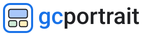
  </picture>
</h1>

<p align="center"><strong>A portrait of your Google Cloud environment.</strong></p>

<p align="center">
  <a href="LICENSE"></a>
  <a href="https://github.com/florianchrometz/gcportrait/actions/workflows/pr.yml"></a>
  <a href="https://github.com/florianchrometz/gcportrait/releases"></a>
  <a href="#self-host-in-10-minutes"></a>
</p>

<p align="center">
  <a href="https://gcportrait.app"><b>Website</b></a> ·
  <a href="https://gcportrait.app/demo/"><b>Demo</b></a> ·
  <a href="docs/README.md"><b>Docs</b></a> ·
  <a href="#self-host-in-10-minutes"><b>Self-host</b></a> ·
  <a href="docs/contributing.md"><b>Contribute</b></a>
</p>

gcportrait draws the actual state of a Google Cloud (GCP) organisation, folder or project as a Google
Cloud-style architecture diagram, built from Cloud Asset Inventory data: folders, projects, VPC networks,
subnetworks and clusters nest as zones, Google Cloud product icons mark the resources, and orthogonal arrows
show every reference between them. You use it three ways: **self-hosted**, as one Cloud Run service in your
own Google Cloud project that one script deploys; as a **web app**, where you explore any scope you can read
with lenses, search, a details drawer and a timeline that moves any view through the last 35 days and marks
what was added, removed or changed; and through its **API**, which returns any view as SVG, PNG or draw.io
without opening the app ([docs/api.md](docs/api.md)). It is made for cloud engineers and architects who need
to understand or document an environment, for security and compliance reviewers checking exposure (public
addresses, peerings, perimeters, Shared VPC), and for platform teams who want a current picture instead of a
hand-drawn one, in a wiki or a pipeline as well as on screen. It is a viewer, not a drawing tool: every box is
a real asset and every arrow a real reference. The instance stores nothing, and your snapshots stay in your
browser.

<p align="center">
  <picture>
    <source media="(prefers-color-scheme: dark)" srcset="docs/media/animated/trace-dark.gif">
    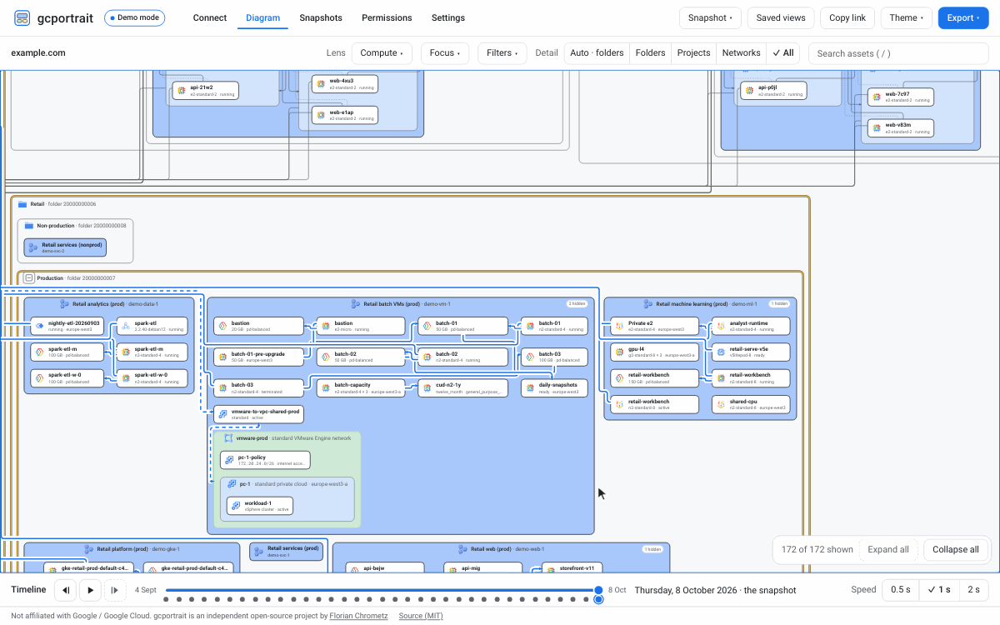
  </picture>
</p>
<p align="center"><sub>Hover, click, trace: the synthetic demo organisation M in the Compute lens.
Animation not playing? Open the still frame (<a href="docs/media/animated/trace-light-poster.webp">light</a>,
<a href="docs/media/animated/trace-dark-poster.webp">dark</a>).</sub></p>

## Quick start

To draw your own environment, run gcportrait in a Google Cloud project of yours with the installer line below.
There is no hosted sign-in service. To look first, [try the demo](#try-the-demo).

### Self-host in 10 minutes

You need a Google Cloud project with billing enabled where you are Owner (or hold [the roles deploy.sh
needs](docs/self-host-options.md#permissions-to-run-deploysh)), and the Google Cloud CLI (Cloud Shell has it).

**1. Deploy.** Sign in, then run the installer with your project id, the one thing it asks for:

```sh
gcloud auth login
curl -fsSL https://gcportrait.app/install.sh | bash -s -- --project YOUR_PROJECT
```

The installer downloads the newest release's deploy scripts, checks them against the release's checksums
before it runs anything, and runs them: they enable the APIs, create a service account with no roles, and
deploy the release's image from GitHub Container Registry (`ghcr.io/florianchrometz/gcportrait`, linux/amd64
and linux/arm64), pulled through an Artifact Registry remote repository in your project. Add `--dry-run` to
see every change first; everything else is an optional flag with a default. Open the address it prints: the
demo works at once.

**2. Create the OAuth client** for "Sign in with Google", the one step Google offers no API for. The script
ends with the console link and the exact origins to add to a new client of the type Web application.

**3. Redeploy with the client id:**

```sh
curl -fsSL https://gcportrait.app/install.sh | bash -s -- --project YOUR_PROJECT --oauth-client-id YOUR_OAUTH_CLIENT_ID
```

Everyone then signs in with their own Google account and sees only what their own IAM permissions allow.

An instance is one Cloud Run service: the app and a small stateless backend, with no database and no stored
token. People sign in with their own Google account and read what their roles allow, or a team grants the
instance's service account `roles/cloudasset.viewer` once (service-account mode, behind a gate that checks
each person's own access to the scope); Cloud Asset Inventory export files load too.
Follow [the self-hosting guide](docs/self-host.md) to deploy, use, update or uninstall an instance.

### Try the demo

**[gcportrait.app/demo](https://gcportrait.app/demo/)** is gcportrait in demo-only mode: no sign-in, no Google
Cloud account, nothing to install. Your browser generates four synthetic organisations (S about 100 assets,
M about 1&nbsp;000, L about 6&nbsp;000, XL about 50&nbsp;000), each with a 35-day history, and gcportrait
draws them as it would draw yours. The released image runs the same app on your machine, with Docker (or a
compatible runtime), for linux/amd64 and linux/arm64:

```sh
docker run --rm --publish 127.0.0.1:8080:8080 ghcr.io/florianchrometz/gcportrait:latest
```

Open <http://localhost:8080>, choose "Try the demo" and pick M. To run it from source instead, see
[docs/contributing.md](docs/contributing.md).

On organisation M, press `/`, search for `10.0.14.5` and press Enter: the virtual machine with that address is
selected, its path traced and its details open. Then switch the Lens to Networking and step through the days
with `[` and `]`. gcportrait works on phones, tablets and desktops with the same controls
([docs/faq.md](docs/faq.md#does-it-work-on-a-phone-or-a-tablet)); dense diagrams read best on a large screen.
[docs/getting-started.md](docs/getting-started.md) has the full first tour.

## Features

**Three ways to use it**, with the same diagrams in each:

- **Self-hosted.** One Cloud Run service in a Google Cloud project of yours, no database and no stored token,
  deployed with one line that asks for your project id and nothing else; with the OAuth client for "Sign in
  with Google", about 10 minutes ([Self-host in 10 minutes](#self-host-in-10-minutes)).
- **Web app.** Sign in with your Google account, pick an organisation, folder or project or load an export
  file, and explore it with everything in the table below. The [demo](#try-the-demo) needs no account.
- **API.** `POST /api/render` on your instance returns any view as SVG, PNG or draw.io, from a live scope, an
  export file, a saved snapshot or a demo organisation, for scripts, docs and reviews
  ([docs/api.md](docs/api.md)). This request returns the PNG of demo S in the Overview lens, the same file as
  the [sample export](docs/media/exports/S-overview-light.png):

  ```sh
  curl -s -H "X-Gcportrait-Token: $(gcloud auth print-access-token)" -OJ \
    --json '{"source":{"kind":"demo","size":"S"}}' https://YOUR_INSTANCE/api/render
  ```

<table>
<tr>
<td width="50%" valign="top">
<h3>Diagrams from real data</h3>
<p>Nothing to draw by hand. Folders, projects, networks and clusters nest as zones, Google’s product
icons sit on every card, and load balancer chains, Shared VPC and every other reference become arrows
routed through the gaps, never across a box.</p>
<picture>
  <source media="(prefers-color-scheme: dark)" srcset="docs/media/stills/hero-dark.png">
  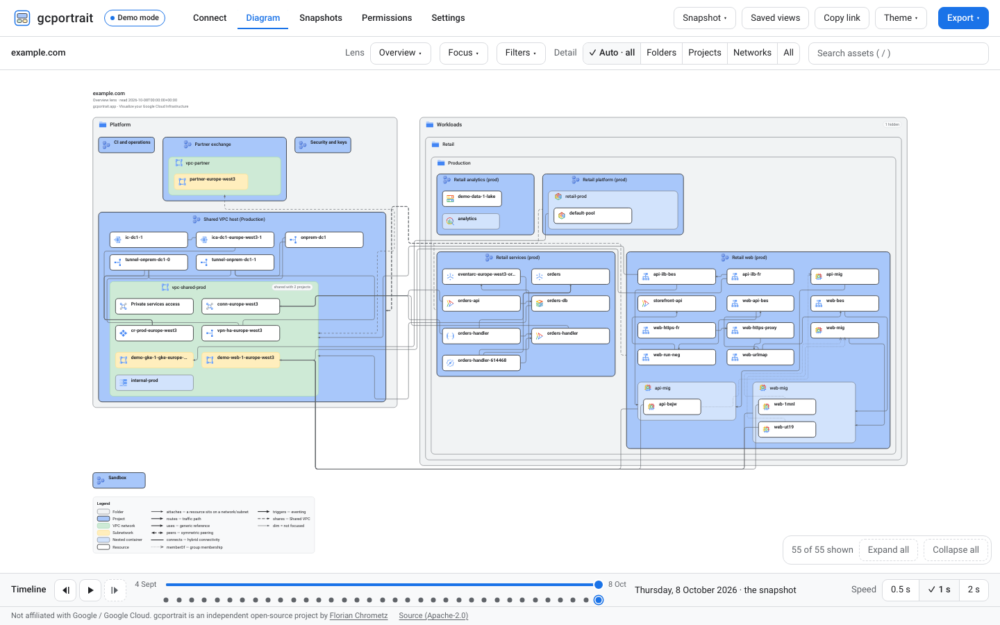
</picture>
</td>
<td width="50%" valign="top">
<h3>Lenses, focus and filters</h3>
<p>Eleven lenses redraw the same organisation: the overview, everything, and one for each question —
networking, load balancing, compute, serverless, Kubernetes, data, security, identity and operations. Focus
on a project, a Shared VPC or a perimeter; filter by region, project, folder, type and depth. The API takes
the same view. <a href="docs/lenses-and-filters.md">Guide</a></p>
<picture>
  <source media="(prefers-color-scheme: dark)" srcset="docs/media/animated/lenses-dark.gif">
  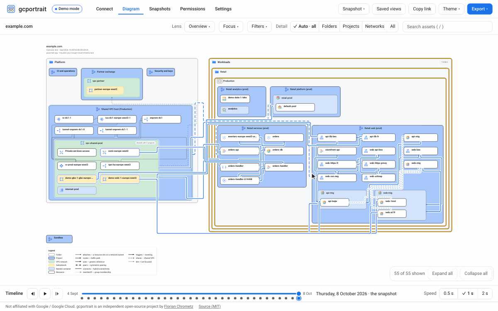
</picture>
</td>
</tr>
<tr>
<td width="50%" valign="top">
<h3>Click to trace, open in the console</h3>
<p>Hover a resource and its path to the top of the organisation lights up; click it and its path and its
connections stay traced, the whole chain behind a load balancer included. The details drawer lists its
facts and relations, and “Open in Cloud Console” opens its page only when you choose it.</p>
<picture>
  <source media="(prefers-color-scheme: dark)" srcset="docs/media/stills/trace-dark.png">
  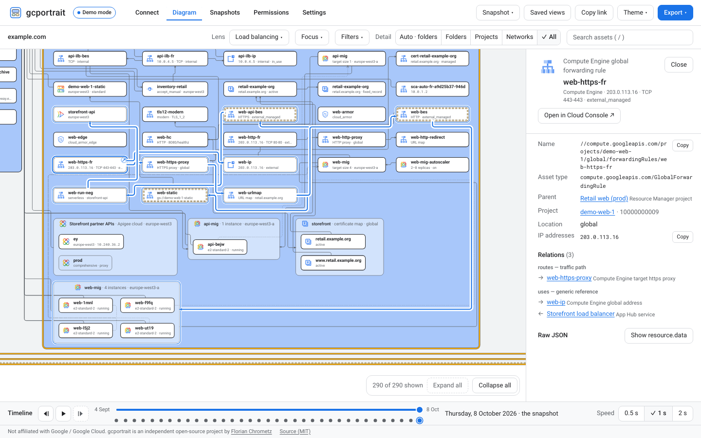
</picture>
</td>
<td width="50%" valign="top">
<h3>A 35-day timeline</h3>
<p>Move any view through the last 35 days, each day read from Cloud Asset Inventory when you stop on it and
kept in your browser. Each day is compared with the day you came from: added resources outlined, removed
ones as ghosts where they stood, changed ones marked. Exports and manual pulls appear as extra ticks, and
the API draws any of those days. <a href="docs/timeline.md">Guide</a></p>
<picture>
  <source media="(prefers-color-scheme: dark)" srcset="docs/media/animated/timeline-dark.gif">
  
</picture>
</td>
</tr>
<tr>
<td width="50%" valign="top">
<h3>Drill in and expand</h3>
<p>Large organisations open collapsed: projects become chips that count what they hold. Click a zone to expand
it in place, double-click to make it the whole canvas; the breadcrumb leads back out.</p>
<picture>
  <source media="(prefers-color-scheme: dark)" srcset="docs/media/animated/drill-in-dark.gif">
  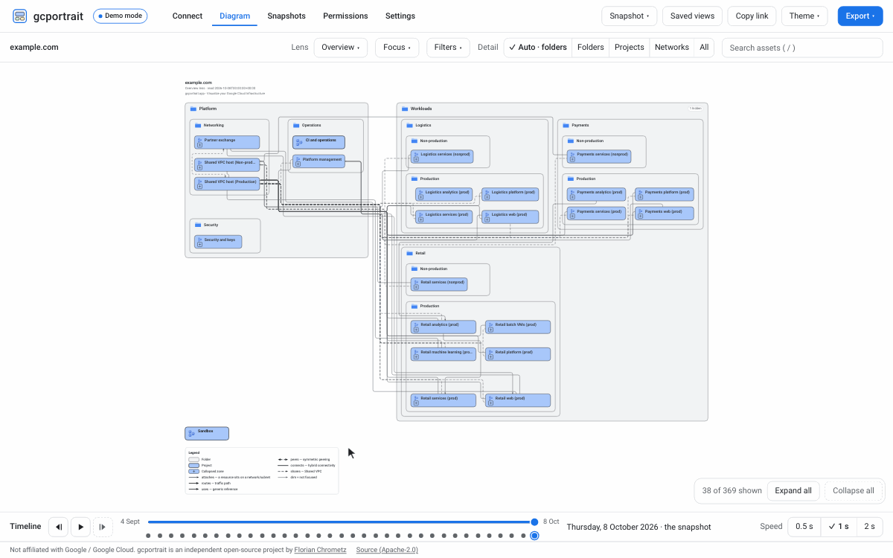
</picture>
</td>
<td width="50%" valign="top">
<h3>Search anything</h3>
<p>Press <code>/</code> to find any asset by name, IP address, domain or project id. Enter selects it, opens
the zones around it and shows its details; if the lens hides it, a dialog offers a way to show it.</p>
<picture>
  <source media="(prefers-color-scheme: dark)" srcset="docs/media/animated/search-dark.gif">
  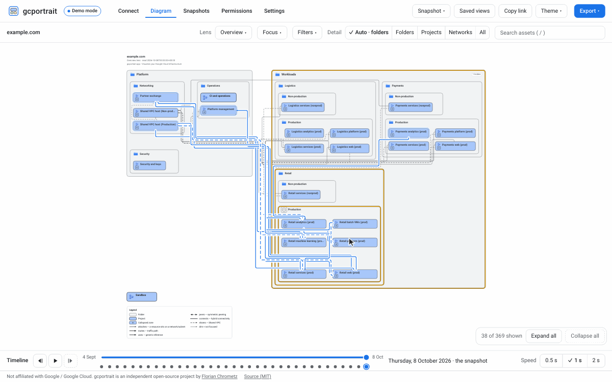
</picture>
</td>
</tr>
<tr>
<td width="50%" valign="top">
<h3>Export SVG, PNG and draw.io</h3>
<p>Save the current view as SVG, as PNG (2× or 3×) or as a draw.io file, the whole diagram or the visible
part, in either theme, with a title block, a legend and the date it shows. Every view is also a link, and a
self-hosted instance draws the same files for scripts through its API (<code>POST /api/render</code>).
<a href="docs/export.md">Guide</a> · <a href="docs/api.md">API</a></p>
<picture>
  <source media="(prefers-color-scheme: dark)" srcset="docs/media/stills/export-dark.png">
  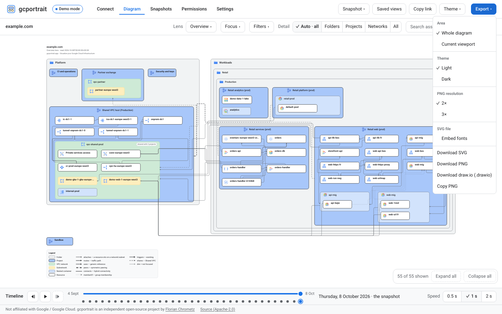
</picture>
</td>
<td width="50%" valign="top">
<h3>Export to draw.io, edit in diagrams.net</h3>
<p>The draw.io file is the drawing as a diagram you can edit, not a picture of it: in diagrams.net or draw.io
every zone is a container that moves with what it holds, every resource a group of its box, Google’s icon and
its label, every arrow a connector between its two resources with its bends, heads and dashes, and the title
block and the legend sit on a layer of their own, in the colours of the theme you exported. It is the SVG
drawing translated, not drawn a second time, and the test suite checks it against the SVG. gcportrait itself
stays a viewer: draw.io is an export, never an import.</p>
<p>Open the <a href="https://gcportrait.app/exports/">sample exports</a> in diagrams.net to try it.
<a href="docs/export.md">The draw.io file</a> ·
<a href="docs/faq.md#why-can-i-not-import-a-drawio-file">Why export only</a></p>
<picture>
  <source media="(prefers-color-scheme: dark)" srcset="docs/media/exports/S-overview-dark-960.webp">
  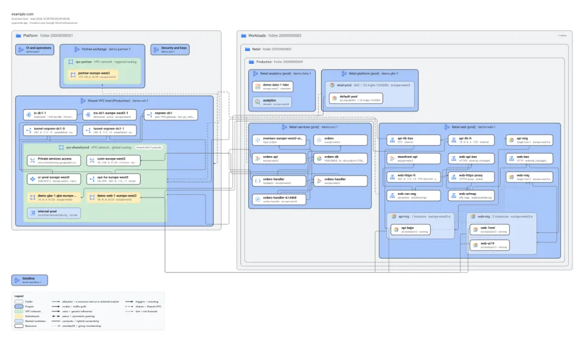
</picture>
</td>
</tr>
<tr>
<td width="50%" valign="top">
<h3>A demo mode, no account needed</h3>
<p>Four synthetic organisations, from about 100 to about 50&nbsp;000 assets, each with a 35-day history,
generated in your browser. Try the diagrams, lenses, search, timeline and export before you deploy anything.
<a href="#try-the-demo">Try it</a></p>
<h3>Your inventory stays in your browser</h3>
<p>Snapshots, the demo’s and your own, live in your browser and leave it only as files you export. The backend
is stateless: it streams what Cloud Asset Inventory returns and keeps nothing; your sign-in token stays in the
tab’s memory.</p>
<picture>
  <source media="(prefers-color-scheme: dark)" srcset="docs/media/stills/snapshots-dark.png">
  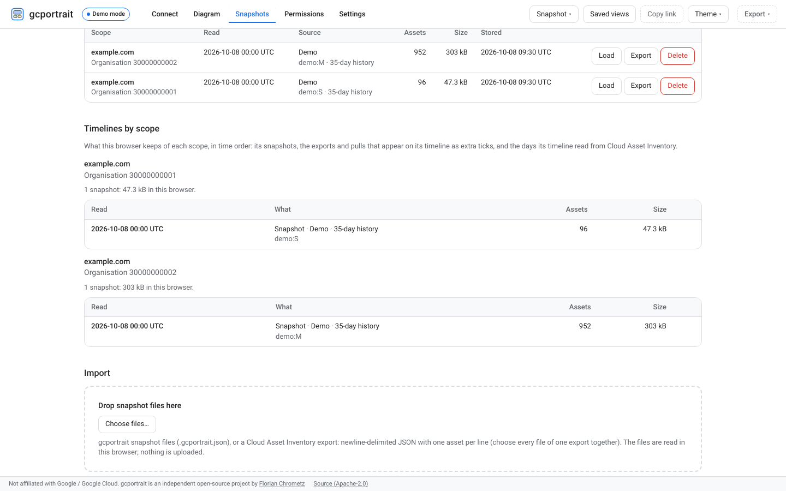
</picture>
</td>
<td width="50%" valign="top">
<h3>Broad asset coverage</h3>
<p>The asset catalog maps Cloud Asset Inventory types, each rule proven by a fixture;
unmapped types are listed with a reason. A type the catalog does not know still renders.
<a href="https://gcportrait.app/coverage/">Current coverage</a> ·
<a href="packages/catalog/README.md">Catalog</a></p>
<picture>
  <source media="(prefers-color-scheme: dark)" srcset="docs/media/exports/M-shared-vpc-dark-960.webp">
  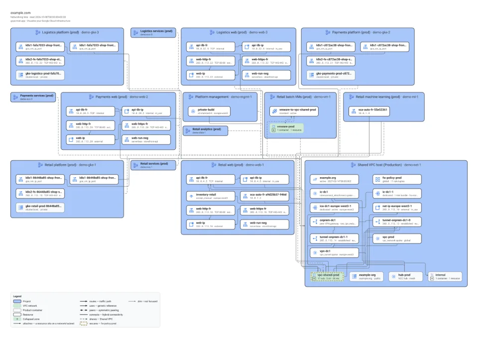
</picture>
</td>
</tr>
<tr>
<td colspan="2" valign="top">
<h3>Light and dark</h3>
<p>Every view in a light and a dark theme, with the same layout, the same tints and Google’s product icons
unchanged. The app follows your system or the theme you pick, and an export, from the app or the API, is drawn
in the theme you choose, whatever the screen shows.</p>
<p>Shown here in the theme you are not using.</p>
<picture>
  <source media="(prefers-color-scheme: dark)" srcset="docs/media/stills/hero-light.png">
  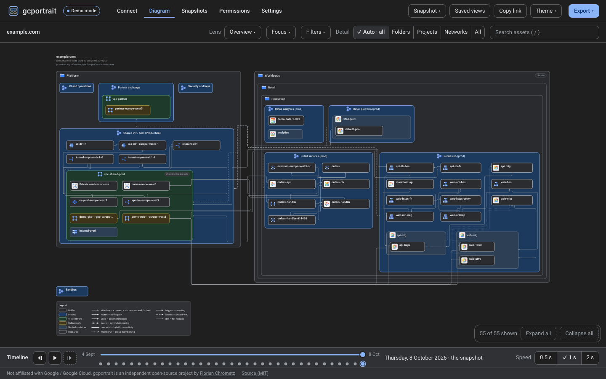
</picture>
</td>
</tr>
</table>

## How it works

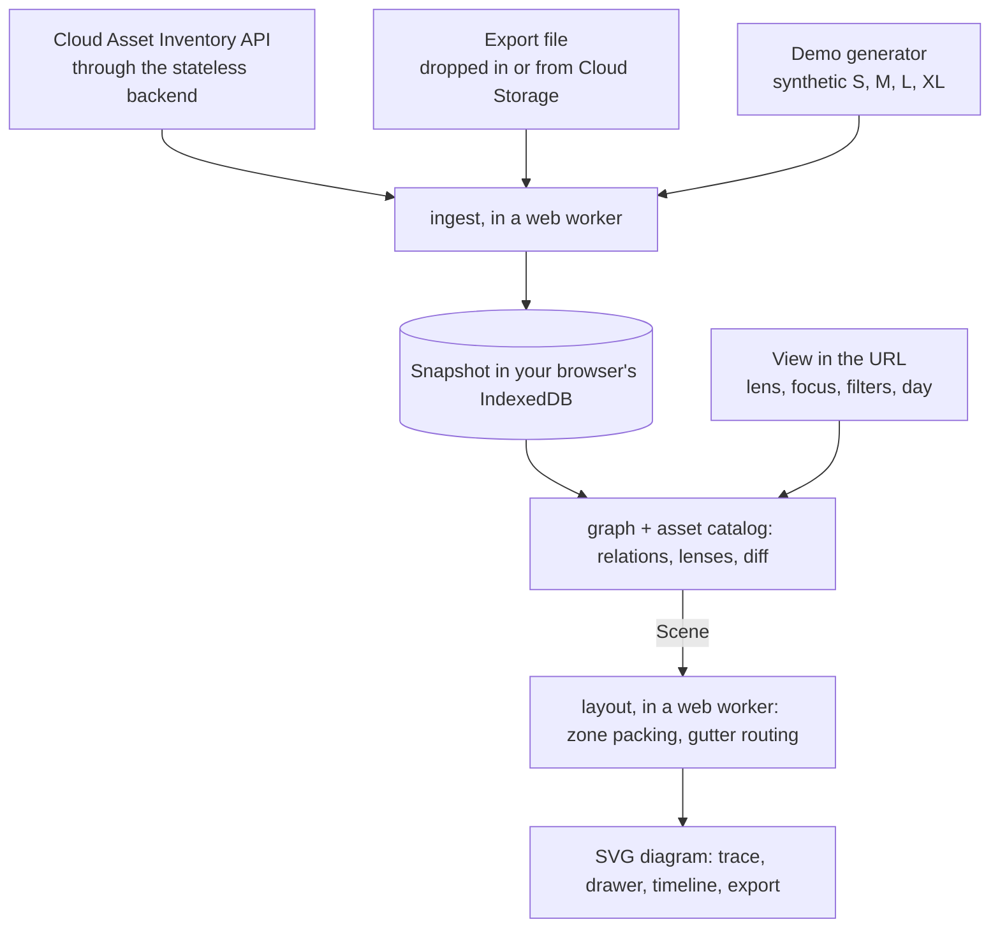

Sources become a Snapshot in the browser, the asset catalog (YAML, about one file per product) turns the
assets' references into typed relations, and the view in the URL selects a Scene. Its own layout engine
packs the nested zones into grids and routes every arrow orthogonally through the gutters between them, in a
web worker, deterministically; React draws the result as SVG. The same pipeline runs without a browser:
`pnpm render --fixture M --lens networking --png out.png` draws a demo view exactly as the app's renderer
draws it. [docs/packages.md](docs/packages.md) maps every package and function on the way.

## Tech stack

- [TypeScript](https://www.typescriptlang.org/) (strict), [Node.js](https://nodejs.org/) 22 and
  [pnpm](https://pnpm.io/) workspaces: one language from the browser to the tooling
- [React](https://react.dev/) 19 and [Vite](https://vite.dev/): the single-page app, with its own pan and
  zoom for a mouse, a pen and a finger, [Fuse.js](https://www.fusejs.io/) for search, and web workers and
  IndexedDB for the data path
- [Fastify](https://fastify.dev/) with [zod](https://zod.dev/) schemas and [pino](https://getpino.io/)
  logs: the stateless backend, on [Cloud Run](https://cloud.google.com/run)
- Its own layout engine: nested-zone grid packing and orthogonal gutter routing in pure TypeScript
- [Vitest](https://vitest.dev/) and [fast-check](https://fast-check.dev/),
  [Playwright](https://playwright.dev/) and [axe-core](https://github.com/dequelabs/axe-core): unit,
  property, end-to-end and accessibility tests
- [resvg-js](https://github.com/thx/resvg-js)'s WebAssembly build, `@resvg/resvg-wasm`: the byte-stable PNGs
  of `pnpm render` and the render API, the same on every platform
- [Astro](https://astro.build/): the website, on GitHub Pages
- [GitHub Actions](https://github.com/features/actions): releases as a distroless container image on GitHub
  Container Registry

## Roadmap

**Tested against stand-ins only**, not on a real Google Cloud project: signing in with your own account behind
Identity-Aware Proxy (`deploy.sh --iap`) and `uninstall.sh --disable-apis`. [docs/backlog.md](docs/backlog.md)
lists what is left, the known limitations and the decisions still open.

**Later, not scheduled:** an opt-in team workspace (shared storage, scheduled snapshots, sharing), IAM policy
and OS inventory layers, Cloud Asset Inventory's relationship data where Security Command Center Premium
provides it, comparing snapshots across scopes, and sharing saved views.

**Not planned:** editing diagrams, cost data, IAM policy analysis beyond showing identities, multi-cloud,
storing snapshots on a server, and real-time feeds ([AGENTS.md](AGENTS.md), "What gcportrait is and is not").

## Contributing

Contributions are welcome, asset types especially: the catalog is data (YAML plus a synthetic fixture), so
adding or correcting a type needs no Google Cloud account. Pull requests are highly welcome; keep each one
small and about one feature or one function rather than a full rewrite. Running gcportrait needs no clone (the
installer above); working on it starts with a fork of the repository and a clone of your fork:

```sh
git clone https://github.com/YOUR_GITHUB_USER/YOUR_FORK.git
cd YOUR_FORK
corepack enable
pnpm install
pnpm dev:demo
```

[docs/contributing.md](docs/contributing.md) takes you from there to a green `pnpm check` and a pull request,
and [AGENTS.md](AGENTS.md) holds the rules of the project, with one `AGENTS.md` per folder that has rules of
its own, for people and AI assistants alike.
Every pull request states that the change is original work. Bugs, ideas and asset-type requests go in an
[issue](https://github.com/florianchrometz/gcportrait/issues/new/choose).

Contributions are accepted under the Apache License 2.0, the project's licence (inbound = outbound): by
opening a pull request you offer your change under it, and you keep the copyright in what you write. There is
no contributor licence agreement (CLA).

## Learn more

- **[gcportrait.app](https://gcportrait.app)**: the website, with the [docs](https://gcportrait.app/docs/)
  and the [asset type coverage](https://gcportrait.app/coverage/); what changed in each version is on the
  [releases page](https://github.com/florianchrometz/gcportrait/releases).
- [docs/README.md](docs/README.md): every guide in this repository. For users: [getting
  started](docs/getting-started.md), [modes](docs/modes.md), [lenses and filters](docs/lenses-and-filters.md),
  the [timeline](docs/timeline.md), [export](docs/export.md) and the [FAQ](docs/faq.md); for running an
  instance: [self-host](docs/self-host.md), its [options](docs/self-host-options.md),
  [permissions](docs/permissions.md) and [configuration](docs/configuration.md).
- **API**: [docs/api.md](docs/api.md), every route an instance serves for scripts, with curl examples: `POST
  /api/render` for SVG, PNG and draw.io renders of a scope, an export file, a snapshot or a demo organisation,
  and the live pull and export read the app streams from.
- For contributors: [docs/contributing.md](docs/contributing.md), the rules of the project in
  [AGENTS.md](AGENTS.md) and the folder files it names, the package map in
  [docs/packages.md](docs/packages.md) and the open work in [docs/backlog.md](docs/backlog.md).

## Author

**Florian Chrometz** & [contributors](https://github.com/florianchrometz/gcportrait/graphs/contributors)

gcportrait is built and maintained by Florian Chrometz. It draws a Google Cloud environment as it actually is:
every box a real asset from Cloud Asset Inventory, every arrow a real reference. Feedback, bug reports and
pull requests are welcome. More about Florian on his [personal website](https://florian-chrometz.de), on
[GitHub](https://github.com/florianchrometz) and in the [author section of the
website](https://gcportrait.app/#author).

## Not affiliated with Google

> [!IMPORTANT]
> gcportrait renders Google Cloud-style architecture diagrams. It is an independent open-source project and is
> not affiliated with, endorsed by, or sponsored by Google. Google Cloud and the Google Cloud product icons
> are trademarks of Google and are used under Google's icon usage terms.

## Licence

gcportrait's own work, its code, its texts and its images, is licensed under the Apache License 2.0
(`Apache-2.0`), copyright 2026 Florian Chrometz: [LICENSE](LICENSE) holds the text and [NOTICE](NOTICE) the
attribution. Source files carry the line `SPDX-License-Identifier: Apache-2.0` within their first ten lines,
and `pnpm provenance` checks every one.

- **What you may do.** Use, copy, modify, merge, publish, distribute, sublicense and sell gcportrait, run it
  for yourself or for others, on its own or as part of your own software or services, as long as the copyright
  notice, the licence text and the `NOTICE` travel with it and modified files say that you changed them. The
  licence asks nothing of an instance you run; the app still links its source in its footer on every page,
  "Source (Apache-2.0)", as a courtesy to the people who use it.
  For a modified version, you can point the backend's `SOURCE_URL` (and `VITE_SOURCE_URL` for a demo-mode
  build) at your source.
- **The name and the icon are reserved.** The gcportrait name and the gcportrait icon are not covered by the
  Apache License 2.0. They identify this project and may not be used to present other software or services as
  gcportrait or as endorsed by it; forks must use their own name and icon. See
  [brand/LICENSE.md](brand/LICENSE.md).
- **Third-party material keeps its own licences.** The npm dependencies, the self-hosted Roboto fonts (SIL
  Open Font License 1.1) and the licence texts under `scripts/licenses/` are listed in
  [THIRD_PARTY.md](THIRD_PARTY.md); `pnpm run licenses` allows only licences that do not reach gcportrait's
  own combined work.
- **Google trademarks.** Google Cloud and the Google Cloud product icons are trademarks of Google, used
  unmodified under Google's icon usage terms ([packages/icons/README.md](packages/icons/README.md)); they are
  not covered by the Apache License 2.0 ([Not affiliated with Google](#not-affiliated-with-google)).
